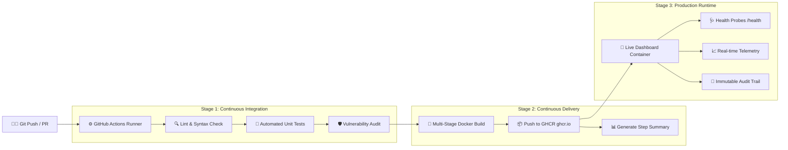

# 🏢 EY Enterprise CloudOps & Compliance Intelligence Platform

> **A Complete Hands-On CI/CD & Cloud Assurance Demonstration for New IT Engineers at EY**  
> Powered by **GitHub Actions**, **GitHub Container Registry (GHCR)**, **Docker Multi-Stage Builds**, and **Automated Quality Gates**.

---

## 🌟 Overview

This repository provides an enterprise-grade demonstration platform designed to teach new IT engineers fundamental and advanced CI/CD, DevOps, and cloud governance concepts.

### Key Capabilities Demonstrated:
1. **Automated Quality Gates (Shift-Left Testing):** Automated syntax linting, unit test execution (12 test cases), and vulnerability scanning prior to packaging.
2. **Multi-Stage Containerization:** Production-ready `Dockerfile` built on minimal Alpine Linux running as an unprivileged, non-root user (`node`).
3. **Automated GHCR Deployment:** Zero-credential secret management using GitHub's native `GITHUB_TOKEN` to build and publish versioned container images directly to `ghcr.io`.
4. **Automated Executive Step Summary:** Workflows automatically generate rich markdown status reports directly within the GitHub Actions console.
5. **Interactive Operations Dashboard:** Real-time metrics, SOC 2/ISO 27001 compliance audit engine, live container health probes, and an interactive **Chaos Engineering** simulator.

---

## 🏗️ Architecture & Pipeline Flow



---

## 🚀 Quickstart Guide

### 1. Run Locally (Node.js)

```bash
# Install dependencies
npm install

# Run code quality & syntax checks
npm run lint

# Execute automated test suite (12 tests)
npm test

# Launch local dashboard
npm start
```
Visit: **`http://localhost:3000`**

---

### 2. Run via Docker Locally

```bash
# Build production multi-stage image
docker build -t ey-devops-dashboard:latest .

# Run container on port 3000
docker run -p 3000:3000 --name ey-dashboard ey-devops-dashboard:latest
```

---

## 🌐 GitHub Actions & GHCR Setup (How to Deploy to GitHub)

To see the automated pipeline run live in your GitHub account:

### Step 1: Initialize Git and Commit
```bash
git init
git add .
git commit -m "feat: Initial commit for EY DevOps Demo Platform"
```

### Step 2: Create a GitHub Repository & Push
1. Go to [github.com/new](https://github.com/new) and create a new repository (e.g., `ey-devops-dashboard`).
2. Link and push your local repository:
```bash
git branch -M main
git remote add origin https://github.com/<YOUR_GITHUB_USERNAME>/ey-devops-dashboard.git
git push -u origin main
```

### Step 3: Watch the Live Workflow
1. Navigate to the **Actions** tab in your GitHub repository.
2. Watch both workflow jobs run in real time:
   - `🛡️ Code Quality & Automated Tests`
   - `🐳 Docker Multi-Stage Build & GHCR Release`
3. View the generated container package under your GitHub profile/organization **Packages** (`ghcr.io/<YOUR_GITHUB_USERNAME>/ey-devops-dashboard`).
4. Read the **Deployment Summary** generated automatically in the workflow run overview.

---

## 📡 REST API Reference

| Endpoint | Method | Description |
| :--- | :--- | :--- |
| `/api/health` | `GET` | Kubernetes/Docker Liveness & Readiness probe (returns uptime, checks, version). |
| `/api/metrics` | `GET` | Live CPU, memory footprint, latency, and CI/CD metadata. |
| `/api/compliance` | `GET` | Regulatory assurance audit scorecard (SOC 2, ISO 27001, CIS, ZTNA). |
| `/api/audit/scan` | `POST` | Triggers an on-demand compliance re-evaluation. |
| `/api/simulate/incident` | `POST` | Chaos engineering toggle to inject latency & pod degradation. |
| `/api/logs` | `GET` | Immutable audit trail stream. |
| `/api/pipeline` | `GET` | CI/CD pipeline configuration and stage definitions. |

---

## 📚 Demo Guide for Presenters

For a complete step-by-step speaker script, presentation outline, and trainee Q&A cheat sheet, refer to:  
👉 **[`DEMO_GUIDE.md`](./DEMO_GUIDE.md)**
